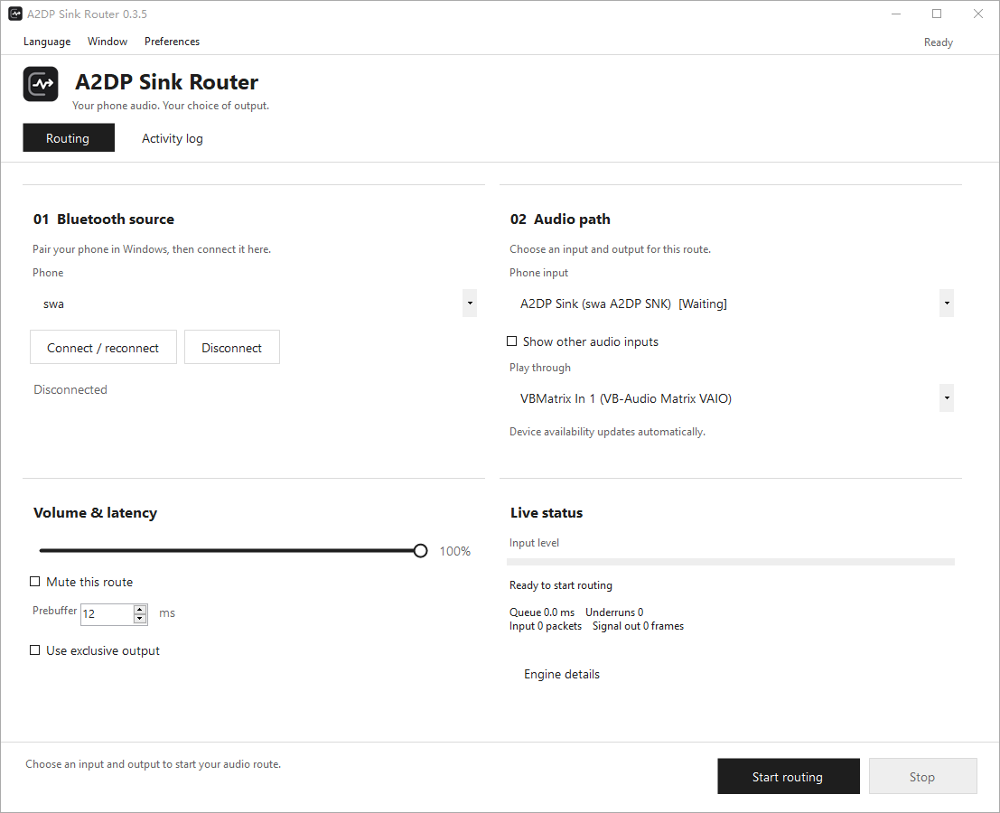

# A2DP Sink Router

Receive Bluetooth audio from your phone on Windows and play it through your preferred headset, speaker, or USB DAC.

**Built to reduce local audio-routing latency by bypassing Windows "Listen to this device".** A dedicated, event-driven WASAPI route replaces the built-in monitoring bridge, with adjustable buffering and direct output selection. No additional audio routing software is required.

**[Download Latest Release](https://github.com/swahex/A2dpSinkRouter/releases/latest)**



## Features

- Discover paired phones; connect, disconnect, and reconnect; remember routing per phone.
- Automatically refresh endpoint availability. Request routing before playback starts, or cancel the pending request.
- Event-driven WASAPI capture and rendering to an explicit output, with shared and optional exclusive modes.
- Bounded buffering, resampling, device-clock drift compensation, route volume, mute, and diagnostic counters.
- First-launch language selection, live Chinese/English switching, saved light/dark themes, and tray controls.
- Minimal divider sections, responsive columns, fixed routing actions, and a separate activity log.

## Why bypass "Listen to this device"?

Windows can forward an A2DP input to a playback device through **Listen to this device**, but its monitoring buffers are managed by the system, with no prebuffer or engine-period controls in the Listen tab. Noticeable monitoring delay is a recurring complaint in vendor support and user feedback.

**A2DP Sink Router replaces that bridge with a route designed for low latency.** Once Windows receives and decodes the Bluetooth audio, the app captures it through event-driven WASAPI and sends it to your chosen output through a bounded queue. It requests the minimum supported shared-engine period, compensates for input/output clock differences, and trims excessive backlog so stale audio does not keep accumulating. You can tune the prebuffer to balance responsiveness and smooth playback, or use exclusive output on compatible devices.

| | Windows "Listen to this device" | A2DP Sink Router |
| --- | --- | --- |
| Local latency tuning | System-managed monitoring; no prebuffer or engine-period controls in the Listen tab | Adjustable 5–100 ms prebuffer, 12 ms default; requests the minimum supported shared-engine period |
| Buffer management | Monitoring queue behavior is not exposed in the Listen tab | Bounded queue, clock-drift compensation and excess-backlog trimming |
| Playback destination | Configured in Windows recording-device properties | Select an explicit headset, speaker or DAC in the app without changing the system default; remember routing per phone |
| Route controls | Enable or disable monitoring in Windows sound properties | Start/stop, volume, mute and cancellation of a pending route in one window |
| Troubleshooting | No monitoring queue or underrun counters in the Listen tab | Queue time, device periods, frame counts, underruns and dropped frames |


## Requirements

- Windows 10 2004 (build 19041) or later, x64.
- A Bluetooth adapter, drivers, and phone compatible with the Windows A2DP sink path.
- **.NET 10 Desktop Runtime x64** for framework-dependent packages. Self-contained builds include the runtime.
- Pair the phone in Windows Bluetooth settings before use.

## Usage

1. Extract the complete application package and keep its files together. Exit an older running version before upgrading.
2. On first launch, choose Simplified Chinese or English. Existing configurations skip this dialog.
3. Select your phone and choose **Connect / reconnect**.
4. Select its A2DP input and your desired output, choose **Start routing**, then play audio on the phone.
5. If the input is not ready, routing waits automatically. **Cancel waiting** removes that request.

Use **Language** to switch languages, **Preferences → Appearance** for light/dark mode, and **Window** to minimize to the tray or exit. Double-click the tray icon to restore the window. Closing the window goes to the tray by default; this preference can be disabled. Stopping the route keeps the Bluetooth connection; exiting releases it.

The default prebuffer target is 12 ms, adjustable from 5 to 100 ms. Stop routing before changing buffer or exclusive-mode settings. Exclusive mode occupies the selected output device.

Smaller buffers are more sensitive to packet arrival jitter and clock differences; the default does not guarantee stable playback on every device. If playback breaks up or the underrun count keeps rising, stop routing, increase the prebuffer (try 40 ms first), and restart routing. A larger buffer adds local waiting time.

Settings and logs are stored in `%LOCALAPPDATA%\A2dpSinkRouter\`. Levels, frame counts, queue times, and device periods are diagnostic values, not end-to-end Bluetooth latency measurements.

This is a portable application. To remove it, exit from the tray and delete its extracted folder. To also clear saved settings and logs, remove `%LOCALAPPDATA%\A2dpSinkRouter\`; **Preferences → Open data folder** opens that location. Bluetooth pairings and separately installed .NET runtimes are managed by Windows.

The launch preference connects the last selected phone once at startup; it does not silently retry forever or restart an audio route. Manual reconnect releases the old phone session. While connecting, **Disconnect** becomes **Cancel connection**. Stopping routing keeps Bluetooth connected; disconnecting also cancels a pending route.

## Build

Install the .NET 10 SDK on Windows, then run from the repository root. `global.json` selects a stable .NET 10 SDK:

```powershell
.\tools\Build.ps1
# Output: artifacts/win-x64/A2dpSinkRouter.exe

# Optional: bundle the runtime (initial restore downloads runtime packages)
.\tools\Build.ps1 -SelfContained

# Optional: synthetic algorithm checks; no sound card or Bluetooth access
.\tools\Build.ps1 -CheckAudioCore

# Build, test and ZIP both deployment modes
.\tools\Package.ps1
```

Node.js is not required to build the application. Icon assets are committed. To regenerate them:

```powershell
npm install --prefix tools/icon @napi-rs/canvas
node tools/Draw-Icon.cjs
```

Choose the **self-contained** ZIP for a machine without .NET installed, or the smaller **framework-dependent** ZIP when .NET 10 Desktop Runtime x64 is already installed. Both packages must be fully extracted. Self-contained builds bundle their own runtime; runtime security fixes require rebuilding and replacing the application package.

Normal pushes to `main` and pull requests targeting `main` run the Windows build and synthetic checks. A matching version tag such as `v0.4.2` runs the release checks, packages both deployment modes, and creates a **draft** GitHub Release using that version's changelog entry. Review the notes and assets before publishing it. Manual CI runs remain available.

The existing Windows API baseline remains build 19041. This is an application compatibility target, not a promise of Microsoft support for every Windows version above that build. See the [.NET Windows support matrix](https://learn.microsoft.com/dotnet/core/install/windows) for supported operating systems; test the package on the intended Windows version.

## Architecture and limits

Windows `AudioPlaybackConnection` manages Bluetooth reception. The data path calls Core Audio directly. One input routes to one output; ASIO, multiple outputs, EQ, and recording are not implemented. Device loss stops an active route and reports an error; starting again is required.

Hardware testing by the maintainer confirmed normal operation across multiple phones, PCs and headsets. Automated regression checks additionally cover synthetic audio buffers, connection lifecycle, Listen-setting detection and device-free UI previews.

## Contributing

See [CONTRIBUTING.md](CONTRIBUTING.md), [CHANGELOG.md](CHANGELOG.md), and [SECURITY.md](SECURITY.md). Include your application version, Windows version, reproduction steps, and sanitized diagnostics in bug reports. Logs may contain device names and identifiers; review them before posting publicly.

## License

Project code, documentation, and icon assets are provided under [MIT](LICENSE). Dependencies retain their own licenses; see [THIRD_PARTY_NOTICES.md](THIRD_PARTY_NOTICES.md).
